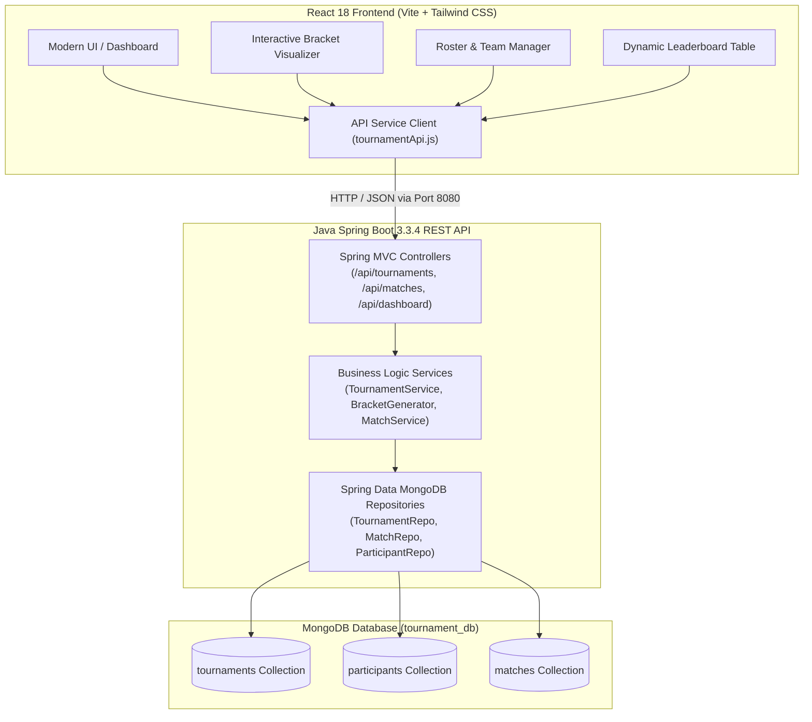

# 🏆 ArenaPulse - Tournament Management Platform

A modern, full-stack tournament management platform built with **React**, **Java Spring Boot**, and **MongoDB**. Supports complete tournament lifecycle management: creating, editing, and deleting tournaments, team/player roster registrations, automated bracket fixture generation (Single Elimination & Round Robin), live match score updates with automatic winner advancement, and dynamic standings leaderboards.

---

## 🚀 Key Features

- **Tournament CRUD Operations**:
  - **Create Tournament**: Title, sport/game, format, dates, capacity, prize pool, location, rules, cover banner.
  - **Edit Tournament**: Update tournament parameters, rules, or status in real time.
  - **Delete Tournament**: Cascading deletion that safely removes all associated brackets, match fixtures, and participant rosters.
  - **Search & Filter**: Search tournaments by title, sport/game, or location; filter by status (*Upcoming*, *Live/Ongoing*, *Completed*, *Draft*) and format.
- **Interactive Visual Brackets**:
  - Automatically generates Single Elimination tournament trees (Quarter-Finals ➔ Semi-Finals ➔ Finals).
  - Click-to-update score modal with instant winner declaration and automatic progression to the next round slot.
- **Round Robin & Standings Leaderboards**:
  - Cyclic match scheduler for all-versus-all leagues.
  - Standings table automatically calculates Matches Played (MP), Wins (W), Draws (D), Losses (L), Goals/Points For (GF), Goals Against (GA), Goal Difference (GD), and Points (PTS) with podium badges (🥇 🥈 🥉).
- **Roster & Participant Management**:
  - Register teams or individual players with seed rankings, emails, and contact details.
  - Enforces tournament capacity limits (e.g. 8/8, 16/16).
- **Executive Analytics Dashboard**:
  - High-level metric cards for total tournaments, active battles, registered rosters, and completed matches.
- **Interactive OpenAPI / Swagger Documentation**:
  - Interactive API playground accessible at `/swagger-ui.html`.

---

## 🏗️ Architecture & Component Overview



---

## 📁 Project Directory Structure

```text
tour/
├── backend/                                   # Java Spring Boot REST API
│   ├── pom.xml                                # Maven configuration with Spring Data MongoDB & OpenAPI
│   ├── Dockerfile                             # Multi-stage Docker build for backend
│   └── src/main/
│       ├── java/com/tournament/
│       │   ├── TournamentApplication.java     # Spring Boot entry point with Mongo Auditing
│       │   ├── config/
│       │   │   └── CorsConfig.java            # Global CORS filter for React
│       │   ├── controller/
│       │   │   ├── TournamentController.java  # CRUD & bracket trigger endpoints
│       │   │   ├── ParticipantController.java # Roster & standings endpoints
│       │   │   ├── MatchController.java       # Fixture & score recording endpoints
│       │   │   └── DashboardController.java   # Platform metrics
│       │   ├── dto/                           # Data Transfer Objects with Bean Validation
│       │   ├── exception/                     # Global exception handler & error response
│       │   ├── model/                         # MongoDB Documents & Enums
│       │   ├── repository/                    # Spring Data Mongo Repositories
│       │   └── service/                       # Bracket engine, scoring, & CRUD services
│       └── resources/
│           └── application.yml                # MongoDB URI & server settings
│
├── frontend/                                  # React 18 Application (Vite + Tailwind)
│   ├── package.json
│   ├── vite.config.js                         # Proxy to Spring Boot on :8080
│   ├── tailwind.config.js
│   ├── index.html
│   ├── Dockerfile                             # Production Nginx container
│   ├── nginx.conf                             # Nginx reverse proxy config
│   └── src/
│       ├── api/tournamentApi.js               # Centralized REST API client
│       ├── components/                        # Modular UI components
│       │   ├── Navbar.jsx
│       │   ├── StatsOverview.jsx
│       │   ├── TournamentCard.jsx
│       │   ├── TournamentModal.jsx            # Create & Edit modal
│       │   ├── DeleteConfirmModal.jsx         # Delete confirmation
│       │   ├── BracketViewer.jsx              # Visual bracket tree
│       │   ├── StandingsTable.jsx             # Standings & leaderboard
│       │   ├── ParticipantManager.jsx         # Team roster management
│       │   ├── MatchScoreModal.jsx            # Score input & winner advancement
│       │   └── FilterBar.jsx                  # Search & filter chips
│       └── pages/
│           ├── DashboardPage.jsx
│           ├── TournamentsPage.jsx
│           └── TournamentDetailPage.jsx
│
├── docker-compose.yml                         # 1-Click launcher (Mongo + Backend + Frontend)
├── standalone-preview.html                    # Zero-install standalone browser edition
├── dev_server.py                              # Lightweight Python preview server
└── README.md
```

---

## ⚡ Quick Start Guide

### Option 1: One-Click Launch via Docker Compose (Recommended)

If Docker is installed on your system, you can build and launch MongoDB, the Spring Boot API, and the React frontend simultaneously:

```bash
docker compose up --build
```

- **Frontend App**: [http://localhost:3000](http://localhost:3000)
- **Spring Boot API**: [http://localhost:8080](http://localhost:8080)
- **Swagger UI API Docs**: [http://localhost:8080/swagger-ui.html](http://localhost:8080/swagger-ui.html)
- **MongoDB**: `localhost:27017`

---

### Option 2: Running Locally (Native Setup)

#### 1. Start MongoDB
Ensure MongoDB is running locally on port 27017:
```bash
mongod --dbpath <data-directory-path>
```
*Or connect to a free [MongoDB Atlas](https://www.mongodb.com/cloud/atlas) cluster by setting the `MONGODB_URI` environment variable.*

#### 2. Start Spring Boot Backend
Navigate to the `backend` directory and run:
```bash
cd backend
mvn spring-boot:run
```
*(The backend starts on `http://localhost:8080`)*

#### 3. Start React Frontend
In a new terminal, navigate to the `frontend` directory:
```bash
cd frontend
npm install
npm run dev
```
*(The frontend dev server starts on `http://localhost:3000` and automatically proxies `/api` calls to the backend on `:8080`)*

---

### Option 3: Zero-Install Instant Preview

Want to explore the entire UI and tournament features right away?

1. **Direct Browser Open**:
   Double-click [standalone-preview.html](file:///c:/Users/sharm/root/tour/standalone-preview.html) in your browser.
2. **Or run via Python**:
   ```bash
   python dev_server.py
   ```
   Open [http://localhost:3000](http://localhost:3000) in your browser.

---

## 📡 REST API Reference

| Method | Endpoint | Description |
| :--- | :--- | :--- |
| `GET` | `/api/dashboard/stats` | Retrieve platform-wide metrics (total, active, participants, matches) |
| `GET` | `/api/tournaments` | List tournaments with optional `?search=` and `?status=` filters |
| `POST` | `/api/tournaments` | Create a new tournament |
| `GET` | `/api/tournaments/{id}` | Retrieve single tournament details by ID |
| `PUT` | `/api/tournaments/{id}` | Edit / update tournament details |
| `DELETE`| `/api/tournaments/{id}` | Delete tournament (cascades delete of participants & matches) |
| `POST` | `/api/tournaments/{id}/generate-brackets` | Generate Single Elimination bracket or Round Robin matches |
| `POST` | `/api/tournaments/seed-demo` | Seed high-quality sample tournaments and fixtures |
| `GET` | `/api/tournaments/{id}/participants` | Get list of registered teams/players |
| `POST` | `/api/tournaments/{id}/participants` | Register a new participant/team |
| `DELETE`| `/api/tournaments/{id}/participants/{pId}` | Remove a participant from the tournament |
| `GET` | `/api/tournaments/{id}/matches` | List all scheduled and completed match fixtures |
| `GET` | `/api/tournaments/{id}/standings` | Get current points and goal difference standings table |
| `PUT` | `/api/matches/{matchId}/score` | Update match score, record winner, and advance bracket |

### Sample Tournament JSON Payload (`POST /api/tournaments`)

```json
{
  "title": "Valorant Champions Invitational 2026",
  "description": "Tier 1 tactical shooter championship featuring top global esports franchises.",
  "game": "Valorant",
  "format": "SINGLE_ELIMINATION",
  "status": "UPCOMING",
  "startDate": "2026-11-15",
  "endDate": "2026-11-20",
  "maxParticipants": 8,
  "prizePool": "$50,000 USD",
  "location": "Reykjavik Arena & Online",
  "rules": "Standard 5v5 defusal rules. Best of 3 matches, Grand Final Best of 5.",
  "bannerUrl": "https://images.unsplash.com/photo-1542751371-adc38448a05e?auto=format&fit=crop&w=1200&q=80"
}
```

---

## 🧪 Testing Tournament Operations

1. **Create Tournament**: Click the **"+ Create Tournament"** button on the navbar, fill in the tournament parameters, and click **Create Tournament**.
2. **Edit Tournament**: Click the **Edit** icon on any tournament card or within the tournament detail header to update dates, capacity, or rules.
3. **Delete Tournament**: Click the **Trash** icon to trigger the safe confirmation modal.
4. **Register Teams**: Open a tournament, navigate to **Roster & Participants**, and add teams (e.g. *Sentinels*, *Fnatic*, *Paper Rex*).
5. **Generate Brackets**: Click **Generate Brackets** to auto-construct the tournament tree.
6. **Record Scores**: In the bracket view, click any matchup card, enter scores (e.g. 2 - 1), mark as completed, and watch the winner automatically advance to the next round!
# exp_10

